# Adaptive Deep Learning-Assisted fcHMRF-LIS for Spatial False Discovery Rate Control in Neuroimaging

A reproducible research prototype combining deep-learning-based Region-of-Interest (ROI) prior detection with the fully connected Hidden Markov Random Field - Local Index of Significance (fcHMRF-LIS) statistical framework for spatial False Discovery Rate (FDR) control in neuroimaging.

---

## 1. Scientific Background & Motivation

In functional Magnetic Resonance Imaging (fMRI), structural MRI, and Positron Emission Tomography (PET), statistical inference involves simultaneous hypothesis testing across $10^5$ to $10^6$ voxels. Controlling the False Discovery Rate (FDR)—the expected proportion of false positives among all rejected null hypotheses:
$$\text{FDR} = \mathbb{E}\left[ \frac{\text{FP}}{\max(\text{FP} + \text{TP}, 1)} \right] \le \alpha$$

Traditional voxel-wise FDR procedures (e.g., Benjamini-Hochberg [BH] or Benjamini-Yekutieli [BY]) treat voxels independently or assume PRDS (Positive Regression Dependency on a Subset). Consequently, they ignore local and long-range spatial context, sacrificing statistical power (True Positive Rate). Conversely, spatial smoothing combined with Cluster-level Random Field Theory (RFT) suffers from well-documented inflation of family-wise error rates and arbitrary cluster-forming threshold selection (Eklund et al., 2016).

The **fcHMRF-LIS** framework addresses this dilemma:
1. **Hidden Markov Random Field (HMRF)**: Represents hidden binary activation states $\theta_i \in \{0, 1\}$ (0 = inactive/null, 1 = active) coupled via spatial and feature similarity graphs.
2. **Fully Connected (fc) Bilateral Graph**: Captures both spatial proximity and radiometric consistency without arbitrary hard cluster cutoffs.
3. **Local Index of Significance (LIS)**: The optimal test statistic under spatial dependence (Sun & Cai, 2009):
   $$\text{LIS}_i = P(\theta_i = 0 \mid \mathbf{Z})$$
4. **Adaptive Deep Learning ROI Prior**: A lightweight 3D CNN estimates prior activation probabilities $\pi_i = P(\theta_i = 1 \mid \text{context})$ to adaptively inform unary potentials without assuming unjustified improvements prior to empirical experimentation.

> **Research Integrity Note**: In accordance with rigorous scientific practice, this repository **makes no claims of scientific superiority** over existing methods until controlled empirical experiments and synthetic benchmarks establish statistically validated evidence.

---

## 2. Mathematical Formulation

### 2.1 Two-Group Mixture Model & Unary Potentials
Let $z_i \in \mathbb{R}$ denote the observed test statistic (z-score) at voxel $i \in \{1, \dots, N\}$. Under the two-group model:
$$f(z_i) = p_0 f_0(z_i) + (1 - p_0) f_1(z_i)$$
where $f_0(z_i) = \mathcal{N}(\mu_0, \sigma_0^2)$ represents the null emission (estimated via Efron's empirical null central matching) and $f_1(z_i) = \mathcal{N}(\mu_1, \sigma_1^2)$ represents the active emission.

The unary energy potential for voxel $i$ incorporates both the likelihood and the deep-learning prior:
$$U_i(0) = -\ln f_0(z_i) - \ln\left(1 - P(\theta_i = 1)\right)$$
$$U_i(1) = -\ln f_1(z_i) - \ln\left(P(\theta_i = 1)\right)$$

where:
$$P(\theta_i = 1) = \lambda_{\text{DL}} \pi_i^{(\text{DL})} + (1 - \lambda_{\text{DL}}) (1 - p_0)$$
Here, $\lambda_{\text{DL}} \in [0, 1]$ balances the deep learning prior relative to the empirical global mixing proportion.

### 2.2 Fully Connected Pairwise Potentials
For edge $(i, j)$, the pairwise interaction potential is defined via a bilateral Gaussian affinity kernel:
$$V_{ij}(\theta_i, \theta_j) = \beta \cdot w_{ij} \cdot \mathbf{1}(\theta_i \ne \theta_j)$$
$$w_{ij} = \exp\left( -\frac{\|\mathbf{p}_i - \mathbf{p}_j\|^2}{2 \sigma_{\text{spatial}}^2} \right) \cdot \exp\left( -\frac{(z_i - z_j)^2}{2 \sigma_{\text{feature}}^2} \right)$$
where $\mathbf{p}_i$ is the physical coordinate of voxel $i$, and $\beta$ is the spatial coupling strength.

### 2.3 Mean-Field Variational Inference
The joint posterior $P(\boldsymbol{\theta} \mid \mathbf{Z})$ is approximated by a fully factorized distribution:
$$Q(\boldsymbol{\theta}) = \prod_{i=1}^N q_i(\theta_i)$$
Fixed-point coordinate ascent yields the iterative update:
$$\ln q_i^{(t+1)}(1) \propto -U_i(1) + \beta \sum_{j \in \mathcal{N}(i)} \tilde{w}_{ij} q_j^{(t)}(1)$$
Damped updates ensure monotonic numerical stability:
$$q_i^{(t+1)} = (1 - \tau) q_i^{(t)} + \tau q_i^{\text{new}}, \quad \tau \in (0, 1]$$

### 2.4 Spatial FDR Control via LIS
1. Compute the Local Index of Significance:
   $$\text{LIS}_i = 1 - q_i(1)$$
2. Sort all voxels by increasing LIS:
   $$\text{LIS}_{(1)} \le \text{LIS}_{(2)} \le \dots \le \text{LIS}_{(N)}$$
3. Find the optimal step-up cutoff index:
   $$k = \max \left\{ j : \frac{1}{j}\sum_{i=1}^j \text{LIS}_{(i)} \le \alpha \right\}$$
4. Reject the null hypothesis for all voxels $\{ (1), \dots, (k) \}$.

---

## 3. Project Architecture

The codebase enforces strict modular decoupling:

```
major_project/
├── configs/                                 # Declarative configuration files
│   ├── default.yaml                         # Master project settings
│   ├── data_config.yaml                     # Simulation & dataset specifications
│   ├── model_config.yaml                    # UNet3D & fcHMRF parameters
│   └── experiment_config.yaml               # Benchmark & robustness matrices
├── src/
│   ├── core/                                # System utilities, seed & config
│   │   ├── config.py                        # Pydantic schema validation
│   │   ├── exceptions.py                    # Domain exception hierarchy
│   │   ├── logging.py                       # Structured log handlers
│   │   └── seed.py                          # Multi-framework seed setter
│   ├── data/                                # Data ingestion & synthesis
│   │   ├── schemas.py                       # Neuroimaging dataclasses
│   │   ├── loaders.py                       # NIfTI & NumPy array loaders
│   │   ├── synthetic.py                     # Synthetic 3D Gaussian random fields
│   │   └── dataset.py                       # PyTorch volumetric datasets
│   ├── preprocessing/                       # Signal preparation
│   │   ├── masking.py                       # Brain extraction & masking
│   │   ├── normalization.py                 # Z-score standardization
│   │   ├── smoothing.py                     # 3D Gaussian spatial filtering
│   │   └── spatial_graph.py                 # k-NN & bilateral coordinate grids
│   ├── deep_learning/                       # Lightweight ROI prior estimation
│   │   ├── models/base_model.py             # Abstract base interface
│   │   ├── models/unet_roi.py               # Lightweight 3D U-Net
│   │   ├── losses.py                        # Focal, Dice, & Focal-Dice loss
│   │   ├── trainer.py                       # Deterministic trainer skeleton
│   │   └── predictor.py                     # Voxel-wise prior probability predictor
│   ├── statistical_analysis/                # Non-spatial & classical FDR
│   │   ├── classical_fdr.py                 # Benjamini-Hochberg (BH) & BY
│   │   ├── storey_qvalue.py                 # Storey's pi_0 & q-values
│   │   ├── local_fdr.py                     # Efron's empirical null locfdr
│   │   └── mixture_models.py                # Two-group EM mixture fitting
│   ├── fchmrf_lis/                          # Spatial inference engine
│   │   ├── graph_potentials.py              # Unary & pairwise bilateral energy
│   │   ├── mean_field.py                    # Damped Mean-Field solver
│   │   ├── lis_calculator.py                # LIS score calculation
│   │   └── spatial_fdr.py                   # Sorted LIS step-up procedure
│   ├── adaptive_parameter_selection/        # Hyperparameter tuning
│   │   ├── base_selector.py                 # Abstract selector interface
│   │   ├── pseudo_likelihood.py             # Maximum Pseudo-Likelihood for beta
│   │   ├── mf_em.py                         # Mean-Field EM for beta & lambda
│   │   └── grid_optimizer.py                # BIC / AIC grid optimizer
│   ├── evaluation/                          # Scientific metrics & reporting
│   │   ├── metrics.py                       # Empirical FDR, Power, FNDR, MCC, Dice
│   │   ├── benchmark.py                     # Multi-method benchmark runner
│   │   └── reporter.py                      # Markdown & CSV export
│   ├── robustness_analysis/                 # Stress testing & sensitivity
│   │   ├── snr_perturbation.py              # Low SNR degradation
│   │   ├── noise_distribution.py            # Heavy-tailed Student's t noise
│   │   ├── null_misspecification.py         # Shifted/scaled null distribution
│   │   └── hyperparameter_sensitivity.py    # Perturbation of beta & lambda
│   ├── visualization/                       # Scientific plotting
│   │   ├── slice_viewer.py                  # Orthogonal 3-plane slice viewer
│   │   ├── statistical_plots.py             # Calibration & power curves
│   │   └── spatial_maps.py                  # Multi-panel discovery maps
│   ├── api/                                 # REST API service
│   │   ├── schemas.py                       # Request & response contracts
│   │   ├── routes.py                        # Endpoints for inference & benchmark
│   │   └── app.py                           # FastAPI application factory
│   └── frontend/                            # Interactive research UI
│       ├── index.html                       # Dashboard layout
│       ├── css/style.css                    # Scientific theme styling
│       └── js/app.js                        # Client API controller
├── experiments/                             # Experiment entrypoints
│   ├── run_synthetic_benchmark.py           # Controlled synthetic simulations
│   ├── run_semisynthetic_benchmark.py       # Realistic resting null + signals
│   ├── run_baseline_comparison.py           # Multi-alpha comparison matrix
│   └── run_robustness_analysis.py           # Robustness stress tests
├── tests/                                   # Unit & integration test suite
│   ├── conftest.py                          # Pytest fixtures
│   ├── test_core.py                         # Core tests
│   ├── test_data.py                         # Data tests
│   ├── test_preprocessing.py                # Preprocessing tests
│   ├── test_statistical_analysis.py         # Statistical analysis tests
│   ├── test_fchmrf_lis.py                   # fcHMRF-LIS tests
│   └── test_adaptive_selection.py           # Adaptive parameter selection tests
├── pyproject.toml                           # PEP 517 build configuration
├── requirements.txt                         # Production dependencies
├── requirements-dev.txt                     # Development dependencies
└── README.md                                # Project documentation
```

---

## 4. Installation & Setup

### Prerequisites
- Python 3.9, 3.10, or 3.11
- Recommended: Virtual environment (`venv` or `conda`)

```bash
# 1. Clone or navigate to the project directory
cd "c:\Users\Lalli\OneDrive\Desktop\major project"

# 2. Create and activate a virtual environment
python -m venv .venv
# On Windows:
.venv\Scripts\activate
# On Linux / macOS:
source .venv/bin/activate

# 3. Install dependencies
pip install -r requirements.txt
pip install -e .
```

---

## 5. Running the Test Suite

The test suite validates data schemas, preprocessing, classical FDR baselines, Mean-Field convergence, LIS step-up thresholding, and adaptive parameter selection:

```bash
pytest tests/ -v
```

---

## 6. Reproducible Experiments

### 6.1 Synthetic Spatial Benchmark
Runs synthetic 3D spatial field simulations with known ground truth activations:
```bash
python experiments/run_synthetic_benchmark.py --snr 2.0 --alpha 0.05 --seed 42
```

### 6.2 Semi-Synthetic Experiment
Evaluates activations injected into realistic correlated background noise:
```bash
python experiments/run_semisynthetic_benchmark.py --alpha 0.05 --snr 2.2 --seed 42
```

### 6.3 Baseline Comparison Across Nominal $\alpha$ Levels
Evaluates $\alpha \in \{0.01, 0.05, 0.10\}$ across BH-FDR, Storey's q-value, Efron's locfdr, standard HMRF-LIS, and Adaptive DL-fcHMRF-LIS:
```bash
python experiments/run_baseline_comparison.py --snr 2.0 --seed 42
```

### 6.4 Robustness & Stress-Testing Suite
Tests resilience against low SNR, non-Gaussian heavy-tailed Student-t noise, shifted null parameters, and hyperparameter sensitivity:
```bash
python experiments/run_robustness_analysis.py --seed 42
```

---

## 7. Interactive Research Dashboard & REST API

Launch the local FastAPI service and interactive web UI:

```bash
uvicorn src.api.app:app --host 127.0.0.1 --port 8000 --reload
```

- **Interactive UI Dashboard**: Open [http://127.0.0.1:8000/ui/index.html](http://127.0.0.1:8000/ui/index.html) in your browser.
- **Interactive OpenAPI Documentation**: Open [http://127.0.0.1:8000/docs](http://127.0.0.1:8000/docs).

### Dashboard Capabilities
1. **Interactive Spatial Slider**: Generate synthetic 3D volumes across varying SNR and cluster configurations.
2. **Axial Slice Visualizer**: Inspect raw z-maps with real-time discovery overlays.
3. **Adaptive vs. Manual Mode**: Toggle deep learning ROI prior assistance and compare adapted coupling parameters ($\beta$, $\lambda_{\text{DL}}$).
4. **Live Benchmark Table**: Directly compare empirical FDR, Power (TPR), FNDR, F1-score, and Dice similarity side-by-side with classical baselines.

---

## 8. Phase 1: Robust Neuroimaging Data Loading & Validation

The Phase 1 data pipeline provides a reusable API for ingesting, validating, and normalizing 3D and 4D NIfTI files (`.nii`, `.nii.gz`) without modifying source files on disk:

```python
from src.data.loaders import load_nifti, validate_image, get_image_metadata

# 1. Structural and numerical validation
report = validate_image("path/to/volume.nii.gz", check_empty=True)
if not report.is_valid:
    print(f"Validation errors: {report.errors}")

# 2. Complete header & metadata inspection
metadata = get_image_metadata("path/to/volume.nii.gz")
print(f"Shape: {metadata.dimensions}, Spacing: {metadata.voxel_dimensions}, Orientation: {metadata.orientation}")

# 3. Load with in-memory canonicalization (RAS+) and float32 representation
volume = load_nifti("path/to/volume.nii.gz", canonical_reorient=True)
print(f"Loaded {volume.spatial_shape} volume with {volume.num_voxels} voxels.")
```

### Key Capabilities:
- **3D & 4D Support**: Ingests single statistical volumes, squeezes singleton 4th dimensions `(X, Y, Z, 1)`, extracts specific temporal indices via `time_index`, or computes temporal averages via `.mean_across_time()`.
- **Structural Integrity Verification**: Validates 4x4 coordinate affine invertibility ($|\det(\mathbf{A}_{:3, :3})| > 10^{-6}$), strictly positive voxel spacings, and catches truncated/corrupted files (`CorruptNiftiError`).
- **Empty Volume & Anomaly Detection**: Detects all-zero or uninformative constant zero fields (`EmptyVolumeError`), and handles non-finite values according to user-defined policies (`nan_policy='zero' | 'error' | 'keep'`).
- **Synthetic Test Suites**: Includes `src.data.sample_data` to generate reproducible 3D statistical maps, 4D fMRI timeseries, and anomaly fixtures without requiring private medical records.

For detailed dataset requirements for downstream 3D U-Net prior learning and fcHMRF-LIS inference, consult [docs/dataset_specifications.md](file:///c:/Users/Lalli/OneDrive/Desktop/major%20project/docs/dataset_specifications.md).

---

## 9. Phase 2: Modular Neuroimaging Preprocessing Pipeline

Phase 2 prepares raw MRI and fMRI contrast maps for 3D U-Net region-of-interest (ROI) segmentation and spatial fcHMRF-LIS false discovery rate control without destroying spatial coordinates or distorting underlying statistical distributions.

### Modular Preprocessing Architecture

```
Raw NIfTI Volume (3D/4D)
         │
         ▼
[ 1. Ingestion & Validation ] ──► In-memory RAS+ canonical reorientation
         │
         ▼
[ 2. Non-Finite Imputation ]  ──► Identifies & fixes NaNs/Infs ('zero' | 'mean' | 'nearest_finite')
         │
         ▼
[ 3. Brain Masking ]          ──► Resolves explicit mask or computes robust Otsu/percentile mask
         │
         ▼
[ 4. Spatial Resampling ]     ──► Resamples to target mm spacing & scales directional affine columns
         │
         ▼
[ 5. Optional Denoising ]     ──► Gaussian (with boundary-preserving normalized convolution) or 3D median
         │
         ▼
[ 6. Intensity Normalization] ──► Standard z-score, robust median-IQR, min-max [0, 1], or percentile clip
         │
         ▼
[ 7. DL Dimension Standard]   ──► Symmetric center padding/cropping to target shape or divisible by 2^L
         │                        (Updates affine origin translation vector: origin_new = origin_old + A @ shift)
         ▼
[ 8. Audit Trail & QC ]       ──► Generates PreprocessingMetadata audit JSON + multi-panel QC figure
         │
         ▼
PreprocessedVolume / PyTorch Tensor (1, 1, D, H, W)
```

### Python API Usage

```python
from src.preprocessing import (
    PreprocessingConfig,
    PreprocessingPipeline,
    preprocess_neuroimaging_volume,
    generate_preprocessing_qc_plot,
)

# Option A: Quick functional preprocessing with parameter overrides
preproc_vol = preprocess_neuroimaging_volume(
    "data/raw/sub01_stat_map.nii.gz",
    normalization_method="zscore",
    pad_crop_mode="pad_to_divisible",
    divisible_by=8,
)

# Option B: Declarative pipeline driven by configuration YAML
config = PreprocessingConfig.from_yaml("configs/preprocessing_config.yaml")
pipeline = PreprocessingPipeline(config=config)
preprocessed = pipeline.run("data/raw/sub01_stat_map.nii.gz")

# Convert directly to PyTorch 3D tensor ready for 3D U-Net forward pass
tensor_3d = preprocessed.to_torch_tensor()  # Shape: (1, 1, D, H, W)

# Save preprocessed volume, mask, and audit metadata JSON
saved_paths = preprocessed.save_preprocessed("data/processed", prefix="sub01")

# Generate visual Quality Control (QC) multi-panel diagnostic figure
from src.data.loaders import load_nifti
raw_vol = load_nifti("data/raw/sub01_stat_map.nii.gz")
qc_file = generate_preprocessing_qc_plot(raw_vol, preprocessed, "outputs/qc/sub01_qc.png")
```

### Command-Line Execution

Run the preprocessing pipeline on any NIfTI volume with automated QC generation:

```bash
python scripts/run_preprocessing.py --input data/raw/sub01_stat_map.nii.gz --config configs/preprocessing_config.yaml --output-dir data/processed --qc-dir outputs/qc
```

---

## 10. Phase 3: Deep Learning-Based ROI Detection Using 3D U-Net

Phase 3 establishes volumetric Region of Interest (ROI) localization before statistical significance analysis using a configurable 3D U-Net in PyTorch.

> [!IMPORTANT]
> **Research Constraint & Scientific Honesty**:
> - The 3D U-Net is evaluated strictly for spatial ROI localization prior to statistical analysis. We do **not** claim scientific improvement over fcHMRF-LIS at this stage until end-to-end controlled experiments are executed.
> - To preserve research integrity and prevent fabricated clinical labels, datasets are strictly partitioned into three transparent operational modes:
>   1. **Supervised Mode**: Requires genuine user-provided 3D NIfTI volumes paired with validated ground-truth binary masks.
>   2. **Pretrained Evaluation Mode**: Loads saved model checkpoint weights (`.pt`) for inference and validation without requiring retraining labels.
>   3. **Synthetic Benchmark Mode**: Uses analytical ground-truth cluster activations defined by mathematical construction (Gaussian random fields with parameterized activation centroids).

### 3D U-Net Architectural Highlights

- **Configurable Hierarchy**: Configurable input channels, output classes, depth ($L=1\dots 5$), base channels, and channel multipliers (`[16, 32, 64, 128]`).
- **Flexible Modules**: Supports multiple activation functions (`relu`, `leaky_relu`, `elu`, `gelu`), normalization layers (`batch_norm`, `instance_norm`, `group_norm`, `none`), and spatial dropout.
- **Divisibility Resilience**: Automatically handles spatial dimensions not divisible by $2^L$ via internal replicate padding and unpadding.
- **Class-Imbalance Losses**: Specialized segmentation losses designed for sparse neuroimaging activations (soft `DiceLoss`, `FocalLoss`, `CombinedBceDiceLoss`, and `FocalDiceLoss`).
- **Evaluation Metrics**: Tracks volumetric Dice coefficient, Jaccard IoU, Precision, and Recall (TPR).
- **Exact Spatial Coordinate Preservation**: Restores original spatial dimensions and exact $4\times 4$ affine matrices during inference, saving segmentation outputs as NIfTI volumes (`_roi_probability.nii.gz` and `_roi_binary.nii.gz`).
- **Hardware Acceleration**: Automatic GPU detection with seamless CPU fallback.

### Python API Usage

```python
import torch
from src.deep_learning import (
    ConfigurableUNet3D,
    CombinedBceDiceLoss,
    ROIPriorTrainer,
    SyntheticROIDataset,
    create_dataloaders,
    segment_volume,
    visualize_roi_segmentation,
    plot_training_curves,
)

# 1. Initialize Configurable 3D U-Net
model = ConfigurableUNet3D(
    in_channels=1,
    out_classes=1,
    base_channels=16,
    depth=3,
    activation="relu",
    norm_type="batch_norm",
)

# 2. Setup Dataset & DataLoaders (Synthetic Benchmark Mode)
train_ds = SyntheticROIDataset(num_samples=30, grid_size=(32, 32, 16), snr=2.5, seed=42)
val_ds = SyntheticROIDataset(num_samples=10, grid_size=(32, 32, 16), snr=2.5, seed=142)
loaders = create_dataloaders(train_ds, val_ds, batch_size=2)

# 3. Train with Metric Tracking & Best Checkpoint Saving
trainer = ROIPriorTrainer(
    model=model,
    loss_fn=CombinedBceDiceLoss(from_logits=True),
    checkpoint_dir="checkpoints",
    learning_rate=1e-3,
)
history = trainer.fit(loaders["train"], loaders["val"], epochs=15, save_best=True)

# 4. Plot Training Dynamics Curves (Loss, Dice, IoU, Precision, Recall)
plot_training_curves(history, output_path="outputs/figures/training_curves.png")

# 5. Volumetric Inference on NIfTI Volume with Spatial Affine Preservation
seg_result = segment_volume(
    "data/raw/sub01_stat_map.nii.gz",
    model=trainer.model,
    threshold=0.5,
    output_dir="outputs/segmentations",
    prefix="sub01",
)
# Returns: probability_map, binary_mask, preserved affine, and saved NIfTI paths

# 6. Multi-Panel Visual Inspection (Original, Predicted ROI, Overlay)
visualize_roi_segmentation(
    original_volume="data/raw/sub01_stat_map.nii.gz",
    predicted_mask=seg_result["binary_mask"],
    probability_map=seg_result["probability_map"],
    output_path="outputs/figures/sub01_roi_inspection.png",
)
```

### Command-Line Execution

Train, benchmark, and evaluate the 3D U-Net from the terminal:

```bash
# Synthetic benchmark training with automated curve generation & demo segmentation
python scripts/train_unet3d.py --config configs/model_config.yaml --epochs 15 --batch-size 2

# Supervised mode (when genuine clinical masks are supplied in config)
python scripts/train_unet3d.py --config configs/model_config.yaml --mode supervised

# Evaluate existing checkpoint without training
python scripts/train_unet3d.py --eval-only --checkpoint checkpoints/unet3d_best_checkpoint.pt
```

---

## 11. Phase 4: Voxel-Level Statistical Testing

Phase 4 generates the voxel-level statistical evidence required by the downstream fcHMRF-LIS spatial FDR control stage.

> [!IMPORTANT]
> **Experimental Design Rigor**:
> - Statistical procedures are **never invented or assumed ad hoc** without an explicit experimental design.
> - The framework supports four standard neuroimaging experimental paradigms:
>   1. **One-Sample t-Test**: Tests group-level mean activation across subjects vs null baseline ($\mu_0 = 0$).
>   2. **Two-Sample Independent t-Test**: Compares two distinct cohorts (e.g. Patients vs Controls) using Welch's unequal variance formulation by default.
>   3. **Paired t-Test**: Evaluates within-subject experimental conditions (e.g. Task A vs Task B, Pre vs Post).
>   4. **Voxel-Wise OLS General Linear Model (GLM)**: Full multiple regression $\mathbf{Y}_v = \mathbf{X} \boldsymbol{\beta}_v + \boldsymbol{\epsilon}_v$ with user-defined contrast vectors $\mathbf{c}^T \boldsymbol{\beta}_v$ for covariate adjustment (e.g. age, motion, behavioral metrics).
>   5. **Direct z-Map Passthrough**: Direct ingestion when the input data is already a computed contrast z-score map.

### Key Capabilities

- **ROI Restriction**: Accepts the ROI mask generated by Phase 3 (3D U-Net) or anatomical atlas, restricting statistical evaluation strictly to active candidate voxels when configured.
- **Statistical Output Suite**: Generates test statistics ($t$, $F$, or $z$), p-values, effect sizes (Cohen's $d$, contrast $\hat{\beta}$), and converted z-scores $z = \Phi^{-1}(1 - p)$.
- **Multi-Subject Handling**: Ingests 4D multi-subject volumes $(X, Y, Z, N)$ or lists of aligned 3D subject `NeuroimagingVolume` objects.
- **NaN / Inf Guard**: Scans for corrupted voxels with configurable handling policies (`mask_out`, `zero`, or `raise`).
- **Affine Coordinate Preservation**: Saves all statistical maps as NIfTI volumes preserving the exact original spatial dimensions and $4\times 4$ coordinate affine matrix.
- **Direct fcHMRF-LIS Compatibility**: The `StatisticalMaps.to_fchmrf_inputs()` method extracts 1D in-mask z-scores, p-values, and 3D spatial masks ready for immediate ingestion by the fcHMRF-LIS inference engine.

### Python API Usage

```python
from src.statistical_analysis import (
    compute_statistics,
    plot_statistical_maps,
    create_one_sample_design,
    create_two_sample_design,
    create_glm_design,
)

# 1. Compute voxel-level statistics on 4D neuroimaging data with ROI restriction
stat_maps = compute_statistics(
    data="data/raw/group_bold_4d.nii.gz",
    roi_mask="outputs/segmentations/sub01_roi_binary.nii.gz",
    test_type="one_sample_t",
    alternative="greater",  # Upper-tail positive activation
    popmean=0.0,
    nan_policy="mask_out",
)

# 2. Inspect statistical fields
print(f"Active ROI voxels: {stat_maps.num_active_voxels:,}")
print(f"Max test statistic: {stat_maps.test_statistic.max():.2f}")
print(f"Min p-value: {stat_maps.p_values[stat_maps.mask].min():.4e}")

# 3. Save aligned NIfTI maps preserving original affine
saved_paths = stat_maps.save_nifti_maps(
    output_dir="outputs/statistical_maps",
    prefix="group_task",
)

# 4. Generate 3-Row Orthogonal Slice Figure (t-stat, -log10(p), effect size)
plot_statistical_maps(
    stat_maps=stat_maps,
    output_path="outputs/figures/group_task_slices.png",
    p_threshold=0.05,
    dpi=300,
)

# 5. Export inputs directly formatted for fcHMRF-LIS (Phase 5)
fchmrf_inputs = stat_maps.to_fchmrf_inputs(restrict_to_mask=True)
# Returns: dict with 'z_scores', 'p_values', 'spatial_mask', 'voxel_coordinates', 'affine'
```

### Command-Line Execution

```bash
# Run voxel-level one-sample t-test restricted to Phase 3 3D U-Net ROI mask
python scripts/run_statistical_testing.py --config configs/statistical_config.yaml

# Run two-sample t-test with custom output locations
python scripts/run_statistical_testing.py --test-type two_sample_t --alternative greater --output-dir outputs/statistical_maps
```

---

## 12. Phase 5: fcHMRF-LIS Spatial Statistical Modeling

Phase 5 implements the core statistical inference engine: the **Fully Connected Hidden Markov Random Field with Local Index of Significance (fcHMRF-LIS)** for spatial False Discovery Rate control in neuroimaging.

> [!IMPORTANT]
> **Methodological Rigor & Attribution**:
> - **Dense All-to-All Interaction**: Unlike sparse grid HMRFs (e.g. 6-neighbor or 26-neighbor Ising models), fcHMRF models long-range spatial correlations across all voxel pairs using high-dimensional bilateral Gaussian filtering without sparse graph truncation.
> - **No False Infeasibility Claims**: The published fcHMRF-LIS approach already includes scalability-related continuous filtering techniques; we do not claim the original method is computationally infeasible.
> - **Clear Methodological Distinction**:
>   1. **Original Published fcHMRF-LIS**: Spatially homogeneous prior $P(\theta_i = 1) = 1 - p_0$ derived purely from the two-group emission mixture, dense bilateral kernel message passing, LIS inversion, and step-up spatial FDR control.
>   2. **Project Adaptive DL Modification**: Adaptively blends the empirical mixture prior with the continuous 3D U-Net localization prior $\pi_i^{(\text{DL})} \in [0, 1]$ via hyperparameter $\lambda_{\text{DL}} \in [0, 1]$. Setting $\lambda_{\text{DL}} = 0$ identically and mathematically recovers the original published fcHMRF-LIS.

### Mathematical Formulation

1. **Latent States & Two-Group Emission**:
   $$\theta_i \in \{0, 1\}, \quad z_i \mid (\theta_i = 0) \sim \mathcal{N}(\mu_0, \sigma_0^2), \quad z_i \mid (\theta_i = 1) \sim \mathcal{N}(\mu_1, \sigma_1^2)$$
   with overall density $f(z) = p_0 f_0(z) + (1 - p_0) f_1(z)$ estimated via Expectation-Maximization.

2. **Unary Potential $\psi_i(\theta_i)$**:
   - **Original fcHMRF-LIS**: $\psi_i(0) = -\log f_0(z_i) - \log p_0, \quad \psi_i(1) = -\log f_1(z_i) - \log (1 - p_0)$
   - **Adaptive DL Modification**:
     $$P(\theta_i = 1) = \lambda_{\text{DL}} \pi_i^{(\text{DL})} + (1 - \lambda_{\text{DL}})(1 - p_0)$$
     $$\psi_i(0) = -\log f_0(z_i) - \log (1 - P(\theta_i = 1)), \quad \psi_i(1) = -\log f_1(z_i) - \log P(\theta_i = 1)$$

3. **Dense Bilateral Affinity Kernel**:
   $$K_{ij} = w_1 \exp\left(-\frac{\|\mathbf{p}_i - \mathbf{p}_j\|^2}{2\sigma_s^2} - \frac{(z_i - z_j)^2}{2\sigma_r^2}\right) + w_2 \exp\left(-\frac{\|\mathbf{p}_i - \mathbf{p}_j\|^2}{2\sigma_{\text{pure}}^2}\right), \quad K_{ii} = 0$$

4. **Dense Mean-Field Variational Fixed-Point Iteration**:
   Let $s_j = 2 q_j(1) - 1 \in [-1, 1]$. The coordinate ascent update is:
   $$\Delta_i = \psi_i(0) - \psi_i(1) + \beta [K \mathbf{s}]_i$$
   $$q_i^{(t+1)} = (1 - \alpha_{\text{damping}}) q_i^{(t)} + \alpha_{\text{damping}} \cdot \frac{1}{1 + e^{-\Delta_i}}$$

5. **Local Index of Significance (LIS)**:
   $$\text{LIS}_i = P(\theta_i = 0 \mid \mathbf{z}) = 1 - Q(\theta_i = 1)$$

6. **Optimal Spatial FDR Control (Sun & Cai 2009)**:
   Sort LIS values $\text{LIS}_{(1)} \le \text{LIS}_{(2)} \le \dots \le \text{LIS}_{(m)}$:
   $$k = \max \left\{ j \in \{1, \dots, m\} : \frac{1}{j} \sum_{i=1}^j \text{LIS}_{(i)} \le \alpha \right\}$$
   Reject all null hypotheses with $\text{LIS}_i \le \text{LIS}_{(k)}$, ensuring $\text{FDR} \le \alpha$ while minimizing False Non-Discovery Rate.

### Python API Usage

```python
from src.fchmrf_lis import (
    FCHMRFModel,
    FCHMRFParameters,
    MethodMode,
    plot_fchmrf_summary,
)

# 1. Configure hyperparameters (Original fcHMRF-LIS or Adaptive DL extension)
params = FCHMRFParameters(
    method_mode=MethodMode.ORIGINAL_FCHMRF,  # Or MethodMode.ADAPTIVE_DL_FCHMRF
    beta=0.8,                               # Spatial coupling strength
    sigma_spatial=2.5,                      # Spatial kernel bandwidth (mm/voxels)
    sigma_intensity=1.5,                    # Contrast feature bandwidth
    lambda_dl=0.5,                          # DL weight (active in adaptive mode)
    alpha=0.05,                             # Nominal spatial FDR target
    max_iterations=40,
)

# 2. Instantiate and run inference on Phase 4 outputs
model = FCHMRFModel(params=params)
result = model.fit_predict(
    z_scores="outputs/statistical_maps/voxel_stat_zscores.nii.gz",
    spatial_mask="outputs/segmentations/sub01_roi_binary.nii.gz",
    dl_prior="outputs/segmentations/sub01_roi_prob.nii.gz",
)

# 3. Access spatial statistical outputs
print(f"Discoveries: {result.num_discoveries:,} / {result.num_analyzed_voxels:,}")
print(f"Cutoff LIS: {result.fdr_results['lis_threshold']:.4f}")
print(f"Estimated FDR: {result.fdr_results['estimated_fdr']:.4f}")

# 4. Save NIfTI volumes preserving original affine matrix
saved = result.save_nifti_results(
    output_dir="outputs/fchmrf_results",
    prefix="sub01_task",
)
# Saves:
# - sub01_task_lis_map.nii.gz
# - sub01_task_significant_mask.nii.gz
# - sub01_task_posterior_prob.nii.gz
# - sub01_task_summary.json

# 5. Generate 6-panel publication diagnostic figure
plot_fchmrf_summary(
    result=result,
    z_scores=result.lis_map,
    output_path="outputs/figures/sub01_fchmrf_summary.png",
    dpi=300,
)
```

### Command-Line Execution

```bash
# Run original published fcHMRF-LIS
python scripts/run_fchmrf_lis.py --config configs/fchmrf_config.yaml --mode original_fchmrf --alpha 0.05

# Run adaptive DL-assisted fcHMRF-LIS
python scripts/run_fchmrf_lis.py --config configs/fchmrf_config.yaml --mode adaptive_dl_fchmrf --lambda-dl 0.5
```

---

## 13. Phase 6: Adaptive Parameter Selection for fcHMRF-LIS

Phase 6 implements a configurable, principled hyperparameter optimization framework to investigate whether automatically selecting model parameters can improve the practical performance of fcHMRF-LIS over predefined default baselines.

> [!IMPORTANT]
> **Scientific Neutrality & Rigor**:
> - **No Assumptions of Superiority**: We do NOT assume that Bayesian Optimization or adaptive selection necessarily improves fcHMRF-LIS. If default parameters are already near-optimal or if the objective landscape is flat, automated optimization incurs search overhead without measurable statistical gain. The experiment must empirically determine whether adaptive selection provides measurable benefit.
> - **Strict Data Leakage Prevention**: Hyperparameters are optimized strictly on a **validation partition**. Final performance and baseline comparisons are evaluated on an **independent held-out test partition**. Never tune parameters on test data!

### Mathematical Formulation

1. **Parameter Search Domain**:
   - $\beta \in [0.1, 2.5]$: Spatial coupling strength (baseline: 0.8).
   - $\sigma_s \in [1.0, 5.0]$: Spatial Euclidean distance bandwidth in mm/voxels (baseline: 2.5).
   - $\sigma_r \in [0.5, 3.5]$: Radiometric contrast feature difference bandwidth (baseline: 1.5).
   - $w_{\text{pure}} \in [0.0, 0.5]$: Isotropic spatial kernel weight (baseline: 0.2).
   - $\lambda_{\text{DL}} \in [0.0, 1.0]$: 3D U-Net localization prior weighting in adaptive mode (baseline: 0.5).

2. **Optimization Objectives**:
   - **Supervised FDR Benchmark Objective**:
     $$\text{Score} = \text{Power} - \gamma \cdot \max(0, \widehat{\text{FDP}} - \alpha)$$
     where $\gamma = 4.0$ heavily penalizes any violation of the nominal spatial FDR $\alpha$, or alternatively $F_1$-score / Matthews Correlation Coefficient (MCC).
   - **Unsupervised Variational ELBO Objective**:
     $$\mathcal{F}(Q) = \mathbb{E}_Q[\log P(\mathbf{z}, \boldsymbol{\theta})] - \mathbb{E}_Q[\log Q(\boldsymbol{\theta})]$$
     evaluating the Evidence Lower Bound on held-out validation voxels when ground truth masks are unavailable.

3. **Gaussian Process Surrogate & Acquisition Functions**:
   $$f(\mathbf{x}) \sim \mathcal{GP}\left(m(\mathbf{x}), k(\mathbf{x}, \mathbf{x}')\right), \quad k(\mathbf{x}, \mathbf{x}') = \sigma_f^2 \text{Mat\acute{e}rn}_{\nu=5/2}(r) + \sigma_n^2$$
   - **Expected Improvement (EI)**:
     $$\text{EI}(\mathbf{x}) = (\mu(\mathbf{x}) - f^+ - \xi) \Phi(Z) + \sigma(\mathbf{x}) \phi(Z), \quad Z = \frac{\mu(\mathbf{x}) - f^+ - \xi}{\sigma(\mathbf{x})}$$
   - **Upper Confidence Bound (UCB)**: $\text{UCB}(\mathbf{x}) = \mu(\mathbf{x}) + \kappa \cdot \sigma(\mathbf{x})$.
   - **Probability of Improvement (PI)**: $\text{PI}(\mathbf{x}) = \Phi(Z)$.

### Python API Usage

```python
from src.adaptive_selection import (
    BayesianOptimizer,
    AcquisitionFunction,
    BaselineComparator,
    ValidationFDRBenchmarkObjective,
    create_fchmrf_search_space,
    plot_adaptive_optimization_summary,
)

# 1. Construct search space
search_space = create_fchmrf_search_space(include_lambda_dl=True)

# 2. Define validation objective (evaluated solely on validation set)
objective = ValidationFDRBenchmarkObjective(
    z_scores_val=val_z_scores,
    ground_truth_val=val_ground_truth,
    target_alpha=0.05,
    max_iterations=25,
)

# 3. Instantiate Bayesian Optimizer
optimizer = BayesianOptimizer(
    search_space=search_space,
    objective=objective,
    acquisition_function=AcquisitionFunction.EXPECTED_IMPROVEMENT,
    xi=0.01,
    seed=42,
)

# 4. Run controlled optimization
opt_result = optimizer.optimize(n_iterations=15, n_initial=5)
print(f"Best Parameters: {opt_result.best_parameters}")
print(f"Validation Score: {opt_result.best_score:.4f} (Baseline: {opt_result.baseline_score:.4f})")

# 5. Save selected parameters to YAML and trial logs to JSON
opt_result.save_results(output_dir="outputs/adaptive_selection", prefix="sub01_adaptive")

# 6. Evaluate baseline vs selected parameters on held-out test data
comparator = BaselineComparator(target_alpha=0.05)
comp_report = comparator.compare(
    baseline_params=opt_result.baseline_parameters,
    selected_params=opt_result.best_parameters,
    z_scores_test=test_z_scores,
    ground_truth_test=test_ground_truth,
    optimization_cost_seconds=opt_result.total_runtime_seconds,
)

# 7. Generate publication diagnostic summary figure
plot_adaptive_optimization_summary(
    opt_result=opt_result,
    comparison_report=comp_report,
    output_path="outputs/figures/adaptive_optimization_summary.png",
    dpi=300,
)
```

### Command-Line Execution

```bash
# Run Bayesian Optimization with Expected Improvement
python scripts/run_adaptive_selection.py --algorithm bayesian_optimization --acquisition expected_improvement --n-iter 15 --n-init 5

# Run Random Search baseline for comparison
python scripts/run_adaptive_selection.py --algorithm random_search --n-iter 20
```

---

## 14. Master Integrated Research Pipeline (Phases 1–6)

The master pipeline provides a unified, production-grade research entry point orchestrating all 6 phases:

$$\text{Neuroimaging Input} \longrightarrow \text{Preprocessing} \longrightarrow \text{3D U-Net ROI Detection} \longrightarrow \text{Statistical Testing} \longrightarrow \text{Adaptive fcHMRF} \longrightarrow \text{LIS} \longrightarrow \text{FDR Control}$$

### Pipeline Architecture Diagram

```mermaid
flowchart TD
    subgraph S1 ["Stage 1: Neuroimaging Input"]
        RawNIfTI["Raw 3D/4D NIfTI (.nii.gz)"] --> Validation["Integrity & Metadata Validation"]
    end

    subgraph S2 ["Stage 2: Modular Preprocessing"]
        Validation --> Impute["Median Imputation"]
        Impute --> Norm["Intensity Normalization (Z-score / Robust)"]
        Norm --> BrainMask["Brain Masking & Resampling"]
        BrainMask --> PreprocVol["Preprocessed Volume (.nii.gz)"]
        PreprocVol --> QCFig["Preprocessing QC Figure"]
    end

    subgraph S3 ["Stage 3: Deep Learning ROI Detection"]
        PreprocVol --> UNet3D["Configurable 3D U-Net"]
        UNet3D --> ROIBin["Binary ROI Mask (.nii.gz)"]
        UNet3D --> ROIProb["Continuous Prior Map pi_DL (.nii.gz)"]
    end

    subgraph S4 ["Stage 4: Voxel-Level Statistical Testing"]
        PreprocVol --> StatEngine["Statistical Test Engine (t-test / GLM)"]
        ROIBin -. Restrict Domain .-> StatEngine
        StatEngine --> ZScores["Voxel-Wise Z-Scores (.nii.gz)"]
        StatEngine --> PValues["Voxel-Wise P-Values (.nii.gz)"]
        StatEngine --> OrthoFig["Orthogonal Statistical Maps"]
    end

    subgraph S6 ["Stage 6: Adaptive Parameter Selection (Optional)"]
        ZScores -. Validation Split .-> BayesOpt["Bayesian Optimization (GP + EI)"]
        ROIProb -. Validation Split .-> BayesOpt
        BayesOpt --> SelParams["Optimized Hyperparameters (YAML)"]
    end

    subgraph S5 ["Stage 5: fcHMRF-LIS Spatial Statistical Modeling"]
        ZScores --> Potentials["Dense Graph Potentials"]
        ROIProb -. Weight lambda_DL .-> Potentials
        SelParams -. Tuned Values .-> Potentials
        Potentials --> DenseMF["Exact Dense Mean-Field Inference"]
        DenseMF --> LIS["Local Index of Significance (LIS)"]
        LIS --> SpatialFDR["Spatial FDR Control (alpha = 0.05)"]
        SpatialFDR --> SigMask["Significant Discovery Mask (.nii.gz)"]
        SpatialFDR --> DiagnosticFig["6-Panel Publication Figure"]
    end

    subgraph Reporting ["Experiment Reporting & Provenance"]
        S1 & S2 & S3 & S4 & S5 & S6 --> ExpReport["Master Experiment Report (JSON & Markdown)"]
    end
```



### Core Architecture Features

1. **Single Entry Point**: Execute the entire workflow through `scripts/run_pipeline.py` or the `MasterPipeline` Python class.
2. **Independent Stage Execution**: Any individual stage can be run standalone via `--stage <stage_name>` (e.g. `--stage roi_detection` or `--stage fchmrf_lis`).
3. **Artifact Caching & Skipping**: Stages automatically detect existing output NIfTI files on disk. Completed stages are skipped (`status=SKIPPED`, `recomputed=false`) in milliseconds. Pass `--force-recompute` to force regeneration.
4. **Hardware Flexibility**: Automatic detection of CUDA GPUs (`device='auto'`) with deterministic fallback to CPU for development and debugging (`device='cpu'`).
5. **Comprehensive Traceability**: Generates a unified experiment report in both JSON and Markdown formats recording runtime environment, hardware accelerators, stage latencies, intermediate NIfTI artifact links, and scientific discovery metrics.

### Python API Usage

```python
from pathlib import Path
from src.pipeline import MasterPipeline, MasterPipelineConfig, PipelineStage

# 1. Instantiate configuration
config = MasterPipelineConfig(
    experiment_id="sub01_master_experiment",
    output_dir=Path("outputs"),
    device="auto",               # Automatically uses CUDA GPU if present
    force_recompute=False,       # Skips existing cached stages
    run_adaptive_selection=True, # Runs Bayesian Optimization tuning
    alpha=0.05,                  # Nominal spatial FDR target
)

# 2. Run end-to-end pipeline
pipeline = MasterPipeline(config=config)
results = pipeline.run()

# 3. Inspect stage results
fchmrf_res = results[PipelineStage.FCHMRF_LIS]
print(f"Status: {fchmrf_res.status}")
print(f"Significant Discoveries: {fchmrf_res.metrics['discoveries']}")
print(f"LIS Cutoff Threshold: {fchmrf_res.metrics['lis_cutoff']:.4f}")
print(f"Artifacts: {fchmrf_res.output_files['lis_map']}")
```

### Command-Line Execution

```bash
# 1. Run Complete Pipeline End-to-End (with cached stage skipping)
python scripts/run_pipeline.py --config configs/pipeline_config.yaml

# 2. Run Complete Pipeline with Adaptive Parameter Selection Enabled
python scripts/run_pipeline.py --config configs/pipeline_config.yaml --adaptive

# 3. Force Full Recomputation of All Stages (Bypass Cache)
python scripts/run_pipeline.py --config configs/pipeline_config.yaml --force-recompute

# 4. Run a Single Stage Independently
python scripts/run_pipeline.py --stage fchmrf_lis
python scripts/run_pipeline.py --stage roi_detection
python scripts/run_pipeline.py --stage statistical_testing

# 5. Run on CPU Explicitly (e.g. for development or CI/CD)
python scripts/run_pipeline.py --device cpu
```

---

## 15. Phase 8: Rigorous Experimental Comparison & Baselines

Phase 8 executes controlled, reproducible benchmark experiments under strictly identical datasets, noise realizations, and coordinate spaces to determine whether the proposed ROI-assisted and adaptive approaches provide measurable empirical benefits.

### Evaluated Multiple-Testing Correction Methods

| Method | Category | Mathematical Description | Hyperparameters |
| :--- | :--- | :--- | :--- |
| **Benjamini-Hochberg (BH-FDR)** | Voxel-wise Baseline | Standard rank-based step-up procedure: $P_{(i)} \le \frac{i}{m} \alpha$. Ignores spatial dependencies. | $\alpha = 0.05$ |
| **Local FDR (Efron lfdr)** | Empirical Bayes Baseline | Two-group mixture model $\text{lfdr}(z_i) = \frac{p_0 f_0(z_i)}{f(z_i)}$ with Gaussian mixture density estimation; controls $\frac{1}{k}\sum_{i=1}^k \text{lfdr}_{(i)} \le \alpha$. | $\alpha = 0.05, p_0 \le 0.95$ |
| **Original fcHMRF-LIS** | Published Reference | Dense all-to-all bilateral Markov random field with spatially uniform emission prior $P(\theta_i = 1) = 1 - p_0$ ($\lambda_{\text{DL}} = 0.0$). | $\beta=0.8, \sigma_s=2.5, \sigma_r=1.5, \lambda_{\text{DL}}=0.0$ |
| **ROI-Assisted fcHMRF-LIS** | Proposed (Fixed) | Dense bilateral fcHMRF integrating continuous 3D U-Net localization prior $\pi_i^{\text{DL}}$ into unary potentials with fixed default weighting. | $\beta=0.8, \sigma_s=2.5, \sigma_r=1.5, \lambda_{\text{DL}}=0.5$ |
| **Adaptive ROI-Assisted fcHMRF-LIS** | Proposed (Optimized) | Dense bilateral fcHMRF with hyperparameters $(\beta, \sigma_s, \sigma_r, \lambda_{\text{DL}})$ optimized via Phase 6 Bayesian Optimization on validation data. | Tuned $(\beta, \sigma_s, \sigma_r, \lambda_{\text{DL}})$ |

### Evaluated Performance & Resource Metrics

1. **Statistical Validity**:
   - **Nominal FDR Target**: $\alpha = 0.05$.
   - **Empirical False Discovery Proportion (FDP)**: $\frac{\text{FP}}{\max(1, \text{TP} + \text{FP})}$.
   - **FDR Control Rate**: Percentage of Monte Carlo simulation runs where $\text{FDP} \le \alpha$.
2. **Detection Power & Sensitivity**:
   - **Power / Sensitivity / Recall / TPR**: $\frac{\text{TP}}{\max(1, \text{TP} + \text{FN})}$.
   - **False Positive Rate (FPR)**: $\frac{\text{FP}}{\max(1, \text{FP} + \text{TN})}$.
   - **Specificity (TNR)**: $\frac{\text{TN}}{\max(1, \text{TN} + \text{FP})}$.
   - **Precision (PPV)**: $\frac{\text{TP}}{\max(1, \text{TP} + \text{FP})}$.
3. **Spatial Localization Fidelity**:
   - **Dice Similarity Coefficient ($F_1$)**: $\frac{2\text{TP}}{2\text{TP} + \text{FP} + \text{FN}}$.
   - **Jaccard Index (IoU)**: $\frac{\text{TP}}{\text{TP} + \text{FP} + \text{FN}}$.
   - **Matthews Correlation Coefficient (MCC)**: Balanced measure incorporating true/false positives and negatives.
   - **Centroid Localization Error**: Euclidean distance in voxel units between true and declared activation centers-of-mass.
4. **Computational Resources**:
   - **Wall-Clock Runtime**: Measured execution latency in seconds.
   - **Peak Memory Usage**: Peak dynamic RAM footprint tracked via Python's standard `tracemalloc` in megabytes (MB).

### Scientific Hypothesis Testing Protocol

> [!IMPORTANT]
> In accordance with rigorous scientific practice, **no method is declared superior *a priori***. The comparative experiment runner objectively tracks whether spatial methods preserve nominal FDR control ($\text{FDP} \le \alpha$) while quantifying the exact power-resolution-runtime trade-offs across all 5 candidates.

### Python API Usage

```python
from src.evaluation import (
    ComparativeExperimentRunner,
    generate_monte_carlo_dataset,
    plot_comparative_benchmark_summary,
)

# 1. Generate multi-trial synthetic neuroimaging dataset with known ground truth
dataset = generate_monte_carlo_dataset(
    num_trials=5,
    shape=(24, 24, 12),
    snr=3.0,
    base_seed=42,
)

# 2. Run all 5 comparative methods under identical conditions
runner = ComparativeExperimentRunner(nominal_alpha=0.05)
report = runner.run_benchmark(dataset=dataset)

# 3. Print ASCII summary table to console
print(report.to_ascii_summary())

# 4. Export CSV and Markdown summary tables
report.export_csv("outputs/tables/phase8_comparative_metrics.csv")

# 5. Generate 4-panel publication diagnostic figure
plot_comparative_benchmark_summary(
    report=report,
    output_path="outputs/figures/phase8_comparative_summary.png",
    dpi=300,
)
```

### Command-Line Execution

```bash
# 1. Run standard comparative benchmark across all 5 methods
python scripts/run_phase8_comparisons.py --config configs/experiment_comparison_config.yaml

# 2. Run benchmark with customized Monte Carlo repetitions and SNR
python scripts/run_phase8_comparisons.py --num-trials 10 --snr 2.5 --alpha 0.05
```

---

## 16. Phase 9: Robustness and Uncertainty Evaluation

Phase 9 stress-tests the stability of the proposed adaptive deep-learning-assisted fcHMRF-LIS pipeline under controlled empirical perturbations, measuring how reliably the declared significant activations replicate across Monte Carlo runs.

### Controlled Stress Conditions

| Stress Experiment | Independent Variable | Tested Range | Evaluated Phenomenon |
| :--- | :--- | :--- | :--- |
| **SNR Sensitivity** | Signal-to-Noise Ratio | $\text{SNR} \in [1.5, 3.5]$ | Power and FDR control degradation at low contrast. |
| **Input Data Perturbation** | Additive Gaussian Voxel Jitter | $\sigma_{\text{pert}} \in [0.0, 0.35]$ | Sensitivity to acquisition noise, head motion, or scanner drift. |
| **Spatial Autocorrelation** | Background Smoothing Kernel | $\sigma_{\text{smooth}} \in [0.0, 2.0]\text{ voxels}$ | Resilience to colored/correlated fMRI noise structures. |
| **Hyperparameter Sensitivity** | Deep-Learning Prior Weight | $\lambda_{\text{DL}} \in [0.2, 0.8]$ | Stability across uniform vs. ROI-dominant priors. |
| **Multi-Seed Uncertainty** | Independent Monte Carlo Seeds | $M \ge 6\text{ seeds}$ | Spatial variance and boundary uncertainty across runs. |

### Stability & Uncertainty Metrics

1. **Pairwise Overlap Stability**:
   $$\text{Mean Pairwise Jaccard} = \frac{2}{M(M-1)} \sum_{j < k} \frac{|\mathcal{D}_j \cap \mathcal{D}_k|}{|\mathcal{D}_j \cup \mathcal{D}_k|}$$
2. **Discovery Count Variance**:
   $$\text{Coefficient of Variation (CV)} = \frac{\sigma_{|\mathcal{D}|}}{\mu_{|\mathcal{D}|}} \times 100\%$$
3. **Voxel-Wise Detection Probability**:
   $$P_{\text{detect}}(v) = \frac{1}{M} \sum_{m=1}^M \mathbb{I}(v \in \mathcal{D}_m)$$
4. **Boundary Shannon Entropy (Uncertainty Map)**:
   $$H(v) = - P_{\text{detect}}(v) \log_2 P_{\text{detect}}(v) - (1 - P_{\text{detect}}(v)) \log_2 (1 - P_{\text{detect}}(v))$$
   Quantifies spatial transition zone ambiguity: $H(v) = 1.0\text{ bit}$ at activation boundaries ($p=0.5$), and $H(v) \approx 0\text{ bits}$ in certain regions ($p=0$ or $p=1$).

### Scientific Constraint

> [!CAUTION]
> **Robustness is not assumed *a priori*.** The evaluation explicitly records breakdown thresholds (e.g. low SNR where power degrades or high additive perturbation where stability drops below acceptable thresholds).

### Python API Usage

```python
from src.robustness import (
    RobustnessEvaluator,
    plot_robustness_analysis_summary,
)

# 1. Initialize robustness evaluator
evaluator = RobustnessEvaluator(
    nominal_alpha=0.05,
    default_beta=0.8,
    default_lambda_dl=0.5,
    max_iterations=30,
)

# 2. Run full multi-dimensional robustness evaluation
report = evaluator.run_full_robustness_evaluation(
    snr_levels=[1.5, 2.5, 3.5],
    perturbation_sigmas=[0.0, 0.15, 0.35],
    spatial_sigmas=[0.0, 1.0, 2.0],
    lambda_dl_values=[0.2, 0.5, 0.8],
    num_seeds=6,
    shape=(20, 20, 10),
)

# 3. Print ASCII summary to console
print(report.to_ascii_summary())

# 4. Export CSV and Markdown reports
report.export_csv("outputs/tables/phase9_robustness_metrics.csv")

# 5. Render 4-panel publication-grade robustness & entropy curves
plot_robustness_analysis_summary(
    report=report,
    output_path="outputs/figures/phase9_robustness_summary.png",
    dpi=300,
)
```

### Command-Line Execution

```bash
# 1. Run standard robustness and uncertainty evaluation
python scripts/run_robustness_evaluation.py --config configs/robustness_config.yaml

# 2. Customize target alpha and Monte Carlo seeds
python scripts/run_robustness_evaluation.py --alpha 0.05 --num-seeds 10
```

---

## 17. Phase 10: Interactive Neuroimaging Visualization and Analysis

Phase 10 provides a research-grade interactive dashboard and visualization suite for inspecting anatomical volumes, 3D U-Net ROIs, voxel-wise statistics, LIS spatial distributions, FDR significance discoveries, and baseline-versus-proposed comparisons.

### Core Scientific Principles & Architecture

1. **Strict Scientific Integrity**:
   Raw voxel values, $z$-statistics, $p$-values, LIS scores, and NIfTI affine matrices are strictly preserved. **No values are cosmetically manipulated, artificially enhanced, or exaggerated to produce stronger-looking activations.**
2. **Abnormality Heatmap Representation**:
   - Base Layer: Grayscale anatomical brain structure.
   - Heatmap Layer: Transparent temperature-style colormap (**Dark Orange $\to$ Orange $\to$ Bright Yellow**) applied exclusively to voxels satisfying statistical/FDR thresholds.
   - Non-significant voxels remain completely transparent to maintain anatomical brain visibility.
3. **Multi-Layer Composition**:
   - 3D U-Net ROI: Translucent cyan/teal structure with independent opacity control.
   - Ground Truth: Outlined/semi-transparent magenta overlay.
   - Baseline vs Proposed: Synchronized dual-panel views and difference discrepancy classification maps ($\text{Consensus}, \text{Proposed-Only}, \text{Baseline-Only}$).
4. **Interactive 2D Tri-Planar Slicing**:
   - Seamless navigation across Axial (XY), Coronal (XZ), and Sagittal (YZ) anatomical planes.
   - Real-time voxel inspector converting grid coordinates $(x, y, z)$ to physical world coordinates $(X, Y, Z)$ in mm via the NIfTI affine matrix:
     $$\mathbf{P}_{\text{world}} = \mathbf{A}_{\text{NIfTI}} \cdot [x, y, z, 1]^T$$
5. **Interactive 3D Brain & Abnormality Isosurface Reconstruction**:
   - Reconstructs 3D volumetric surfaces using Marching Cubes (`skimage.measure.marching_cubes`) rendered with Plotly 3D (`Mesh3d`).
   - Anatomical brain shell (semi-transparent neutral gray), 3D U-Net ROI surface (cyan), and statistical abnormalities (semi-transparent orange/yellow).
   - Full 360-degree free rotation, zoom, pan, and structure visibility toggles.

### Dashboard Layout (3-Panel Research Interface)

- **Left Panel (Sidebar — Data & Controls)**:
  - File uploader supporting `.nii` and `.nii.gz` volumes, or one-click benchmark loader with known ground truth.
  - View selector (2D Tri-Planar, Interactive 3D Brain, Baseline Comparison).
  - Layer visibility toggles (Original MRI, Preprocessed, 3D U-Net ROI, Statistics, LIS, FDR Significant, Ground Truth).
  - Fine-grained sliders (Slice, Heatmap Opacity, MRI Opacity, ROI Opacity, $|z|$ Threshold, LIS Cutoff, Palette).
- **Center Panel (Main Canvas)**:
  - High-resolution Plotly visualization with pan, zoom, hover inspection, and 360-degree 3D rotation.
- **Right Panel (Analysis Information & Voxel Inspector)**:
  - Active slice indices and anatomical plane readout.
  - Physical world millimeter coordinate inspector.
  - Quantitative discovery metrics: Discovery count, percentage of volume, baseline comparisons.
  - Scientific integrity audit statement.

### Launching the Dashboard

```bash
# 1. Launch via CLI runner
python scripts/run_dashboard.py --port 8501

# 2. Or launch directly via Streamlit
streamlit run src/visualization/dashboard_app.py
```

### Python API Usage

```python
from src.visualization import (
    build_interactive_slice_figure,
    build_interactive_3d_brain_figure,
    build_method_comparison_figure,
    build_difference_map_figure,
    load_research_benchmark_session,
)

# 1. Load or initialize research pipeline session
session = load_research_benchmark_session(shape=(24, 24, 12), snr=3.2)

# 2. Build 2D tri-planar slice figure with grayscale MRI and temperature heatmap
fig_2d = build_interactive_slice_figure(
    mri_volume=session.mri_volume,
    orientation="axial",
    slice_idx=6,
    roi_mask=session.roi_mask,
    statistical_map=session.statistical_map,
    fdr_significant_mask=session.proposed_significant_mask,
    affine=session.affine,
    show_fdr_significant=True,
    heatmap_colorscale="temperature",
)

# 3. Build 3D brain and abnormality surface figure
fig_3d = build_interactive_3d_brain_figure(
    mri_volume=session.mri_volume,
    roi_mask=session.roi_mask,
    significant_mask=session.proposed_significant_mask,
    affine=session.affine,
)
```

---

## 18. Phase 11: FastAPI Backend for Interactive Neuroimaging Analysis

Phase 11 provides a secure, decoupled **FastAPI REST backend** orchestrating neuroimaging data ingestion, preprocessing, deep-learning prior estimation, voxel statistics, fcHMRF-LIS spatial inference, and data delivery for the Phase 10 interactive visualization frontend.

### Architectural Separation

The system follows a strict unidirectional design pattern:
$$\text{Frontend (Phase 10)} \longrightarrow \text{FastAPI Routes} \longrightarrow \text{Service Layer} \longrightarrow \text{Research Computation} \longrightarrow \text{Sandboxed Storage} \longrightarrow \text{Frontend}$$

No mathematical algorithms or volumetric transformations are executed inside FastAPI route handlers.

```
backend/
├── main.py                    # Application factory, CORS, exception handlers, Swagger docs
├── core/
│   ├── config.py             # Declarative settings (storage dirs, upload limits, CORS origins)
│   ├── security.py           # Path sanitization, NIfTI magic bytes & size verification
│   └── logging.py            # Structured request and experiment logging
├── schemas/
│   ├── common.py             # ErrorResponse, HealthResponse
│   ├── upload.py             # UploadResponse
│   ├── pipeline.py           # PreprocessRequest, SegmentRequest, FCHMRFLISRequest, PipelineRun
│   ├── results.py            # ResultsResponse, ExperimentMetadataResponse
│   └── visualization.py      # VisualizationMetadataResponse, SliceDataResponse, Mesh3DResponse
├── services/
│   ├── storage_service.py    # Sandboxed experiment storage trees (storage/exp_xxx/...)
│   ├── upload_service.py     # NIfTI verification, metadata parsing, sandboxed persistence
│   ├── pipeline_service.py   # Asynchronous stage execution and status tracking
│   ├── result_service.py     # Results aggregation, discovery counting, provenance
│   └── visualization_service.py # 2D slice extraction and 3D Marching Cubes mesh generation
├── research/                 # Isolated adapters invoking underlying research modules
│   ├── preprocessing.py      # PreprocessingPipeline integration
│   ├── segmentation.py       # 3D U-Net ROI extraction
│   ├── statistics.py         # Voxel-level z-scores and p-values
│   ├── fchmrf.py             # fcHMRF-LIS spatial modeling
│   └── fdr.py                # Benjamini-Hochberg FDR baseline
└── api/                      # Modular APIRouters
    ├── upload.py             # POST /upload
    ├── preprocess.py         # POST /preprocess
    ├── segmentation.py       # POST /segment
    ├── statistics.py         # POST /statistics
    ├── fchmrf.py             # POST /fchmrf-lis
    ├── pipeline.py           # POST /run-pipeline, GET /pipeline/status/{id}
    ├── results.py            # GET /results/{id}, GET /experiment/{id}
    └── visualization.py      # GET /visualization/{id}, /slice, /3d-mesh
```

### Core API Endpoints

| Method | Endpoint | Description |
|---|---|---|
| `GET` | `/health` | Service health check and storage accessibility verification |
| `POST` | `/upload` | Secure `.nii`/`.nii.gz` upload with header validation and experiment ID generation |
| `POST` | `/preprocess` | Executes intensity normalization and brain masking |
| `POST` | `/segment` | Runs 3D U-Net ROI prior probability and binary mask detection |
| `POST` | `/statistics` | Calculates voxel-wise test statistics ($z$-scores) and $p$-values |
| `POST` | `/fchmrf-lis` | Fits two-group mixture, runs dense mean field, and controls LIS FDR |
| `POST` | `/run-pipeline` | Triggers complete asynchronous background pipeline execution |
| `GET` | `/pipeline/status/{id}` | Live execution state (`preprocessing`, `fchmrf-lis`, `completed`) and progress % |
| `GET` | `/results/{id}` | Summary of available layers, discovery counts, and artifact references |
| `GET` | `/experiment/{id}` | Complete provenance, timestamps, spatial dimensions, and parameters |
| `GET` | `/visualization/{id}` | Visual dimensions, voxel spacing, affine, and raw value ranges |
| `GET` | `/visualization/{id}/slice` | Raw 2D slice arrays (axial/coronal/sagittal) for grayscale + temperature heatmap |
| `GET` | `/visualization/{id}/3d-mesh` | Marching Cubes vertices & faces for 360° brain and abnormality rotation |

### NIfTI Security & Path Isolation

1. **Path Traversal Prevention**: Client-specified paths and filenames are strictly stripped of directory separators, null bytes, and traversal syntax (`..`).
2. **Magic Byte Verification**: Checks gzip magic header (`1f 8b`) and NIfTI-1/2 magic bytes (`n+1\0`, `ni1\0`) before passing to parsers.
3. **Upload Size Limits**: Configurable via `MAX_UPLOAD_SIZE_MB` (default: 250 MB).
4. **Sandboxed Directory Tree**:
   ```
   storage/
     exp_a1b2c3d4/
       input/           <- raw_volume.nii.gz, ground_truth.nii.gz
       preprocess/      <- preprocessed.nii.gz, brain_mask.nii.gz
       segmentation/    <- roi_mask.nii.gz, dl_prior.nii.gz
       statistics/      <- z_scores.nii.gz, p_values.nii.gz
       fchmrf/          <- lis_map.nii.gz
       fdr/             <- significant_mask.nii.gz, baseline_significant.nii.gz
       visualization/   <- cached meshes & metadata
       metadata.json    <- experiment parameters and status
   ```

### Launching the Backend

```bash
# 1. Launch via CLI runner
python scripts/run_backend.py --host 127.0.0.1 --port 8000 --reload

# 2. Or run directly with Uvicorn
uvicorn backend.main:app --host 127.0.0.1 --port 8000 --reload
```
Interactive OpenAPI documentation will be accessible at:
- Swagger UI: `http://127.0.0.1:8000/docs`
- ReDoc: `http://127.0.0.1:8000/redoc`

---

## 19. Phase 12: Interactive Research Dashboard (React + Vite)

The **Phase 12 Research Dashboard** is a clean, responsive web application for demonstrating the complete neuroimaging analysis pipeline. It directly interfaces with the Phase 11 FastAPI backend (`http://127.0.0.1:8000`).

> [!WARNING]
> **RESEARCH PROTOTYPE — NOT FOR CLINICAL DIAGNOSIS**  
> *This system is developed for research and demonstration purposes only. It has not been validated, approved, or intended for clinical diagnosis, treatment decisions, or medical use.*

### Technology Stack & Frontend Architecture

```
frontend/
├── package.json
├── vite.config.js               # Reverse proxy to FastAPI (port 8000)
├── index.html                   # Inter & JetBrains Mono typography
└── src/
    ├── main.jsx                 # Application mount with ExperimentProvider
    ├── App.jsx                  # Main layout: Header, Stepper, Sidebar, Workspace
    ├── index.css                # Research dark slate styling and animations
    ├── api/                     # Decoupled API service layer
    │   ├── client.js            # Axios client with 120s timeout & error handling
    │   ├── uploadApi.js         # POST /upload with progress tracking
    │   ├── pipelineApi.js       # Preprocess, segment, statistics, fchmrf, run-pipeline
    │   ├── resultsApi.js        # Slices, 3D meshes, layer availability, downloads
    │   └── experimentApi.js     # Metadata, experiment history, and health check
    ├── state/
    │   └── ExperimentContext.jsx # Central state: active exp, slices, layers, status
    ├── utils/
    │   ├── colormap.js          # Scientific temperature colormap & affine mapping
    │   └── canvasRenderer.js    # Multi-layer compositing on HTML5 Canvas
    └── components/
        ├── Header/              # Brand, experiment picker, API health, disclaimer
        ├── PipelineStepper/     # Stage progression indicator (Upload -> Export)
        ├── SidebarPanels/       # Controls for Upload, Preprocessing, U-Net, Statistics,
        │                        # Parameter Selection (Manual vs Adaptive), fcHMRF, FDR
        ├── Visualization/       # 2D Tri-Planar Slices, Voxel Inspector, 3D Brain Viewer
        ├── BaselineComparison/  # Side-by-side & Discrepancy Classification Map
        ├── MetricsTable/        # Quantitative statistics, FDR, Dice, and TPR
        ├── ComputationalTime/   # Latency breakdown per pipeline stage
        ├── ExperimentHistory/   # Provenance log with one-click reload
        ├── DownloadResults/     # NIfTI artifacts, CSV metrics, JSON metadata
        └── ResearchInfo/        # Mathematical definitions of fcHMRF-LIS
```

### Key Capabilities

1. **Mandatory Research Disclaimer**:
   Prominently placed at the top of the interface: *"Research Prototype — Not for Clinical Diagnosis. This system is developed for research and demonstration purposes only. It has not been validated, approved, or intended for clinical diagnosis, treatment decisions, or medical use."*
2. **Visual Pipeline Stepper**:
   Indicates live stage progression (`✓ Upload → ✓ Preprocess → ✓ ROI Detection → ✓ Statistics → ● fcHMRF-LIS → ○ FDR → ○ Results`) with verified backend states (`pending`, `running`, `completed`, `failed`).
3. **Tri-Planar 2D Slice Viewer & Scientific Heatmap**:
   - Supports Axial, Coronal, and Sagittal cross-sectional planes with real-time slider and zoom (1.0x to 5.0x).
   - Base Layer: Anatomical Grayscale MRI.
   - Temperature Colormap: Dark Orange $\to$ Standard Orange $\to$ Vivid Yellow representing actual $(1 - \text{LIS})$ or $|z|$ significance strength without artificial distortion.
   - Non-significant voxels remain completely transparent so underlying anatomical brain tissue is preserved.
4. **Interactive Voxel Inspector**:
   Hovering over any voxel displays:
   - Grid coordinates: $(x, y, z)$
   - Physical world coordinates: $(X, Y, Z)$ in mm calculated via the affine matrix: $\mathbf{P}_{\text{world}} = \mathbf{A} \cdot [x, y, z, 1]^T$
   - Raw MRI intensity, statistical $z$-score, LIS value, $1 - \text{LIS}$, and binary FDR discovery status.
5. **Interactive 3D Brain Isosurface Viewer**:
   - Renders Marching Cubes triangular meshes extracted by the backend (`brain_shell`, `roi_mesh`, `significant_mesh`).
   - Supports 360-degree rotation (mouse drag), zoom (mouse wheel), and individual surface visibility toggles.
6. **Objective Baseline vs Proposed Comparison**:
   - Synchronized side-by-side comparison between standard Benjamini-Hochberg (BH) FDR and Proposed Adaptive fcHMRF-LIS.
   - Discrepancy Classification Map: Consensus discoveries (green), Proposed-Only discoveries (orange), Baseline-Only discoveries (blue).
7. **Quantitative Metrics & Latency Breakdown**:
   - Direct reporting of discoveries, empirical FDR, sensitivity, specificity, precision, recall, and Dice similarity score.
   - Real stage-by-stage computational latency bars.
8. **Export & Provenance**:
   - One-click reload from experiment history (`/experiments`).
   - Download sliced NIfTI artifacts (`.nii.gz`), summary CSV metrics, JSON metadata, and publication-quality canvas snapshots.

### Running the Research Dashboard

```bash
# 1. Start the FastAPI backend
python scripts/run_backend.py --host 127.0.0.1 --port 8000 --reload

# 2. In a separate terminal, launch the React frontend
python scripts/run_frontend.py --port 3000
# Or directly via npm
cd frontend && npm install && npm run dev
```
Open `http://localhost:3000` (or `http://localhost:5173`) in your web browser.

---

## 20. Phase 13: Automated Research Experiments & Systematic Experiment Runner

The **Automated Research Experiment Suite** (`src/experiments/`) provides a systematic, reproducible evaluation framework capable of executing parameter sweeps across datasets, signal-to-noise ratios, models, and random seeds.

### 1. Recorded Provenance per Experiment
Every single experiment execution records a complete, audit-ready provenance payload (`ExperimentResult`):
- **Dataset**: synthetic generation parameters (`grid_size`, `snr`, `num_clusters`, `cluster_radius`, `noise_distribution`) or NIfTI source paths.
- **Preprocessing Configuration**: normalization method (`zscore`, `robust`, `minmax`), percentiles, smoothing FWHM, brain mask.
- **U-Net Configuration**: enabled flag, checkpoint path, architecture depth/filters, ROI threshold, prior mode.
- **Statistical Test**: test type (`one_sample_t`, `two_sample_t`, `glm`), null hypothesis, alternative (`greater` vs `two-sided`), ROI restriction flag.
- **fcHMRF Parameters**: method mode, $\beta$, $\sigma_{\text{spatial}}$, $\sigma_{\text{intensity}}$, $\lambda_{\text{DL}}$, nominal $\alpha$, max iterations, tolerance, damping $\tau$.
- **Adaptive Optimization Settings**: optimizer type (`bayesian_optimization`), iterations, initial design points, acquisition function (`expected_improvement`, `ucb`, `pi`).
- **Random Seed**: multi-framework deterministic seed initialized across Python, NumPy, and PyTorch.
- **Evaluation Metrics**: empirical FDR, True Positive Rate (Power), False Positive Rate, Specificity, Precision, Recall, Dice/F1 similarity, MCC, discovery count.
- **Runtime Breakdown**: separate wall-clock timings for data loading, preprocessing, 3D U-Net inference, statistical testing, adaptive tuning, and fcHMRF inference.
- **Output Artifact Locations**: absolute paths to all saved NIfTI volumes, JSON configurations, result metadata, CSV metrics, and diagnostic plots.
- **System Environment Metadata**: OS platform, Python version, NumPy, SciPy, PyTorch, CUDA acceleration state, and NiBabel versions.

### 2. Automatically Generated Artifacts
For each individual experiment:
- `config.json` & `config.yaml`: Complete, standalone declarative configuration.
- `result.json`: Detailed execution status, metrics, runtimes, and system metadata.
- `metrics.csv`: Machine-readable metric spreadsheet.
- `diagnostic_summary.png`: 5-panel publication-grade figure showing (1) MRI + Ground Truth contour, (2) 3D U-Net Prior map, (3) Voxel-level $z$-scores, (4) LIS map $P(H_0 | Z)$, (5) FDR discoveries temperature overlay.
- Aligned NIfTI files: `preprocessed.nii.gz`, `roi_mask.nii.gz`, `z_scores.nii.gz`, `lis_map.nii.gz`, `significant_mask.nii.gz`.

For batch experiment suites:
- `suite_summary.csv`: Master comparative spreadsheet across all tested conditions and methods.
- `suite_summary.json`: Complete aggregated result structure.
- `comparison_table.md`: GitHub Flavored Markdown table comparing Empirical FDR, TPR (Power), Precision, Dice score, Discoveries, and Latency.
- `comparison_table.tex`: Publication-ready LaTeX `tabular` snippet for research papers.
- `suite_metrics_comparison_bar.png`: Multi-method bar chart of key metrics with nominal $\alpha$ reference line.
- `suite_runtime_breakdown_bar.png`: Stacked stage latency breakdown per method.
- `suite_fdr_power_calibration.png`: Empirical FDR vs Power trade-off plot.

### 3. CLI Usage

```bash
# 1. Run the default systematic benchmark suite (SNR 1.5 & 2.5 across all 4 methods)
python scripts/run_experiments.py --suite configs/experiment_suite.yaml

# 2. Run a custom parameter sweep matrix directly via CLI arguments
python scripts/run_experiments.py --snr 1.0 2.0 3.0 --methods baseline_bh original_fchmrf proposed_fchmrf proposed_adaptive_fchmrf --seed 42 --alpha 0.05

# 3. Run a single specific experiment configuration
python scripts/run_experiments.py --config outputs/automated_experiments/exp_snr2.5_proposed_fchmrf_seed42/config.json

# 4. Reproduce a specific experiment from its configuration with bit-for-bit numerical verification
python scripts/reproduce_experiment.py --config outputs/automated_experiments/exp_snr2.5_proposed_fchmrf_seed42/config.json
```

### 4. Single-Command Exact Reproduction & Verification
The `scripts/reproduce_experiment.py` tool re-runs any previously saved experiment with the identical configuration and seed, performs a side-by-side numerical comparison against the original `result.json`, and outputs a verification audit table:

```
================================================================================
REPRODUCIBILITY VERIFICATION REPORT
================================================================================
Metric                    | Original        | Reproduced      | Delta        | Match
--------------------------------------------------------------------------------
num_discoveries           | 412             | 412             | 0            | [OK] MATCH
empirical_fdr             | 0.038835        | 0.038835        | 0.000000     | [OK] MATCH
tpr                       | 0.884112        | 0.884112        | 0.000000     | [OK] MATCH
precision                 | 0.961165        | 0.961165        | 0.000000     | [OK] MATCH
dice                      | 0.921021        | 0.921021        | 0.000000     | [OK] MATCH
mcc                       | 0.915432        | 0.915432        | 0.000000     | [OK] MATCH
================================================================================
[SUCCESS] Experiment replicated with exact numerical bit-for-bit / scientific fidelity!
```

---

## 21. Phase 14: Publication-Quality Scientific Evaluation & Systematic Ablation Studies

The **Publication Evaluation Suite** (`src/evaluation/publication_framework.py`, `src/evaluation/ablation.py`, `src/evaluation/statistical_testing.py`) provides an empirical validation framework specifically designed for scientific manuscript preparation and peer-reviewed publication.

### 1. Research Questions & Hypotheses
- **RQ1 (Spatial Power & Error Control)**: Does dense spatial dependency modeling via fcHMRF-LIS achieve higher statistical power (TPR) than standard mass-univariate procedures (BH-FDR, Storey-q, Efron-locfdr) while maintaining finite-sample empirical FDR $\le \alpha$?
- **RQ2 (Component Isolation)**: What is the isolated marginal contribution of (a) the 3D U-Net deep learning ROI prior ($\pi_{\text{DL}}$), and (b) Bayesian adaptive hyperparameter selection $(\beta, \lambda_{\text{DL}})$, when integrated into fcHMRF-LIS?
- **RQ3 (Localization & Calibration)**: Does the fully integrated ROI-assisted Adaptive fcHMRF-LIS yield statistically significant improvements in spatial localization accuracy (Dice/MCC) without causing activation bleed across anatomical boundaries?

### 2. Systematic 4-Arm Ablation Study
To ensure scientific integrity without claiming novelty merely from combining existing methods, the framework decomposes contributions across four controlled ablation arms:
- **Arm A (fcHMRF-LIS alone)**: The baseline published spatial Markov random field model without deep learning assistance ($\lambda_{\text{DL}} = 0.0$, whole-brain domain, fixed $\beta = 0.8$).
- **Arm B (ROI + fcHMRF-LIS)**: Deep Learning 3D U-Net prior map $\pi_{\text{DL}}$ incorporated into unary potentials with fixed coupling weight ($\lambda_{\text{DL}} = 0.5$, ROI-focused domain, fixed $\beta = 0.8$).
- **Arm C (Adaptive fcHMRF-LIS)**: fcHMRF-LIS with Bayesian Optimization (Gaussian Process with Matérn 5/2 kernel and Expected Improvement) adaptively selecting $\beta$, but without deep learning assistance ($\lambda_{\text{DL}} = 0.0$, whole-brain domain).
- **Arm D (ROI + Adaptive fcHMRF-LIS — Full Proposed Method)**: The complete proposed architecture combining 3D U-Net structural prior with joint Bayesian adaptive selection of $(\beta, \lambda_{\text{DL}})$.

### 3. Additive Component Contribution Attribution
For any evaluation metric $M$ (e.g. Statistical Power, Empirical FDR, Dice Similarity, Precision):
- **Marginal Spatial Modeling Contribution**: $\Delta_{\text{spatial}} = M(\text{Arm A}) - M(\text{BH-FDR})$
- **Marginal 3D U-Net Prior Contribution**: $\Delta_{\text{ROI}} = M(\text{Arm B}) - M(\text{Arm A})$
- **Marginal Adaptive Optimization Contribution**: $\Delta_{\text{adaptive}} = M(\text{Arm C}) - M(\text{Arm A})$
- **Synergy / Non-Linear Interaction**: $\Delta_{\text{synergy}} = M(\text{Arm D}) - [M(\text{Arm A}) + \Delta_{\text{ROI}} + \Delta_{\text{adaptive}}]$
- **Net Improvement over Published fcHMRF**: $\Delta_{\text{net}} = M(\text{Arm D}) - M(\text{Arm A})$

### 4. Rigorous Statistical Testing & Effect Sizes
- **Paired Hypothesis Testing**: Paired Student's $t$-test and non-parametric Wilcoxon signed-rank test across Monte Carlo realisations.
- **Parametric Effect Size**: Paired Cohen's $d_z = \frac{\bar{D}}{s_D}$.
- **Non-Parametric Effect Size**: Cliff's delta $\delta = \frac{\#(y > x) - \#(y < x)}{n_x n_y}$.
- **Family-Wise Error Rate Control**: Holm-Bonferroni step-down correction on $p$-values across tested hypotheses.

### 5. Automatically Generated Publication Artifacts
Executing the publication suite automatically compiles:
- `publication_ablation_metrics.csv`: Machine-readable summary of means and standard deviations across all SNR levels and arms.
- `publication_ablation_table.md`: GitHub Flavored Markdown comparison table.
- `publication_ablation_table.tex`: LaTeX `table*` snippet formatted for immediate inclusion into IEEE / Nature / NeuroImage LaTeX templates.
- `component_attribution_summary.md`: Detailed waterfall delta analysis quantifying exact component gains.
- `scientific_evaluation_report.md`: Complete technical evaluation report detailing hypotheses, empirical findings, statistical test tables, and conclusions.
- `fig1_ablation_performance_bars.png`: 4-panel publication bar chart (Power, Empirical FDR, Dice, Precision) with nominal $\alpha$ reference line.
- `fig2_component_attribution_waterfall.png`: Contribution waterfall chart decomposing Power gains.
- `fig3_snr_sensitivity_curves.png`: Sensitivity curves across Signal-to-Noise Ratios (1.5, 2.0, 2.5).

### 6. CLI Execution

```bash
# 1. Run full publication evaluation suite (SNRs: 1.5, 2.0, 2.5 across 5 seeds)
python scripts/run_publication_evaluation.py --output-dir outputs/publication_evaluation --snr 1.5 2.0 2.5 --n-seeds 5

# 2. Run fast single-SNR ablation evaluation for development
python scripts/run_publication_evaluation.py --output-dir outputs/publication_evaluation --snr 2.0 --n-seeds 3 --grid-size 32 32 16
```

---

## 22. Phase 16: Automated Final Research Report Generator

The **Final Research Report Generator** (`src/reporting/generator.py`, `src/reporting/data_collector.py`, `scripts/generate_final_report.py`) provides an automated pipeline that synthesizes all experimental outputs across the project into an exhaustive, publication-grade research manuscript.

### 1. The 16 Canonical Research Sections
The generator automatically populates the 16 standard scientific report sections without fabricating numerical results:
1. **Project Title**: Formal title detailing ROI-Assisted Adaptive fcHMRF-LIS methodology.
2. **Research Objective**: Motivation, trade-offs between mass-univariate FDR control and spatial smoothing, and core aims.
3. **Dataset Description**: Synthetic Gaussian Random Field benchmark specification with known ground-truth activation geometries and varying SNRs.
4. **Neuroimaging Preprocessing**: Intensity normalization, Otsu brain extraction, spatial alignment, and standardized $z$-score transformation.
5. **3D U-Net Methodology**: Multi-scale 3D U-Net architectural details, Group Normalization, and continuous prior probability map generation.
6. **Statistical Testing**: Voxel-level null hypothesis formulation, $z$-score conversion, and central-matching empirical null estimation.
7. **fcHMRF-LIS Methodology**: Latent Gibbs random field modeling, unary/pairwise potentials, Mean-Field variational inference, permutohedral lattice filtering, and Local Index of Significance (LIS) FDR thresholding.
8. **Adaptive Parameter Optimization**: Bayesian Optimization with Gaussian Process surrogate modeling and Expected Improvement on validation data without data leakage.
9. **Experimental Setup**: Multi-seed Monte Carlo protocol, signal-to-noise ratio sweeps, and metric formulations.
10. **Baseline Methods**: Benjamini-Hochberg FDR, Efron's Local FDR, Original fcHMRF-LIS, ROI-assisted fcHMRF, and Adaptive ROI-fcHMRF.
11. **Experimentally Observed Results**: Rigorously documented empirical findings from actual benchmark runs, embedded tables, and 4-panel figures.
12. **Systematic Ablation Study**: 4-arm ablation breakdown (Arms A, B, C, D) and additive component attribution ($\Delta_{\text{spatial}}$, $\Delta_{\text{ROI}}$, $\Delta_{\text{adaptive}}$, $\Delta_{\text{synergy}}$).
13. **Robustness Analysis**: SNR sensitivity curves, additive noise perturbation resistance, spatial correlation resilience, and Shannon boundary entropy maps.
14. **Limitations & Scientific Scope**: Explicit documentation of assumptions, simulated-to-real gap, computational scaling considerations, and prior sensitivity.
15. **Conclusion**: Objective summary grounded strictly in experimental observations.
16. **Future Work**: Actionable directions including in vivo 7T fMRI validation, multi-modal anatomical priors, and variational graph autoencoders.

### 2. Rigorous Distinction of Scientific Categories
The generator enforces a strict typographic and structural separation between:
- **Experimentally Observed Results**: Verified empirical values, statistical hypothesis tests, confidence intervals, and effect sizes.
- **Theoretical & Methodological Assumptions**: Standard Gaussian null models, Markovian spatial priors, and smoothness bounds.
- **Scientific Limitations**: Known caveats, computational scaling bounds, and simulation scope.
- **Future Work**: Future empirical hypotheses and planned algorithmic extensions.

### 3. Generated Publication Artifacts
Executing the generator compiles:
- `FINAL_RESEARCH_REPORT.md`: Exhaustive GitHub-Flavored Markdown report with embedded relative figures and tables.
- `FINAL_RESEARCH_REPORT.tex`: Standalone, two-column IEEE/Nature-ready LaTeX manuscript with tables and citations.
- `FINAL_RESEARCH_REPORT.html`: Interactive, self-contained HTML report with KaTeX math rendering and responsive design.
- `tables/*.csv`: Machine-readable CSV exports of all 5 experimental tables.
- `figures/*.png`: 3 publication-grade summary figures (Comparative Evaluation, Ablation Waterfall, and Robustness Uncertainty Maps).

### 4. CLI Execution

```bash
# 1. Generate full final research report with live benchmark and ablation execution
python scripts/generate_final_report.py --output-dir reports/final_report --snr 1.5 2.0 2.5 --n-seeds 3

# 2. Fast generation for development/testing
python scripts/generate_final_report.py --output-dir reports/final_report --snr 2.0 --n-seeds 2 --grid-size 32 32 16
```

---

## 23. Reproducibility & Research Protocol

1. **Fixed Random Seeds**: All stochastic processes (random field generation, dataset sampling, EM updates, GP restarts) use `src.core.seed.set_seed(42)` for multi-framework determinism across Python, NumPy, and PyTorch.
2. **Declarative Configurations**: All hyperparameters and matrices are stored in `configs/*.yaml` and `configs/*.json`.
3. **No Unjustified Claims**: Theoretical benefits are stated as hypotheses to be verified empirically via the experiment runners.
4. **Lightweight Scope**: Avoids unnecessarily heavy GNNs, transformers, or federated setups at this prototype stage.


